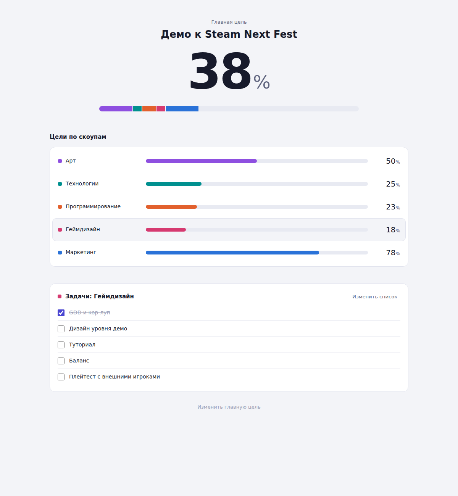

# Прогресс команды

Минималистичный дашборд, который показывает, насколько команда продвинулась к главной цели. Цель разбита на рубежи — подцели, которые проверяются снаружи (страница опубликована, демо живёт). Внутри рубежа работа поделена на аспекты (скоупы), у каждого свои крупные задачи с критериями закрытия. Всё, что меняется на сайте или через Claude, сразу видят все участники.



## Возможности

- Четыре уровня: главная цель с показателем (например, вишлисты и лестница ориентиров) → лестница рубежей → аспекты рубежа с одной фразой «что аспект даёт рубежу» → задачи.
- Процент считается внутри рубежа, поэтому не откатывается, когда расписываются задачи следующих рубежей. Общий бар рубежа состоит из цветных отрезков — вклада каждого аспекта.
- Задача закрывается после подтверждения с именем того, кто принял результат. Критерии приёмки и зависимости хранятся в данных и доступны Claude, но на сайте не показываются и закрытию не мешают: при закрытии с сайта критерии отмечаются сами.
- Вернуть задачу в работу нельзя, пока закрыты задачи, которые от неё зависят: прогресс не противоречит сам себе.
- Прогресс считается по весам задач: крупная задача двигает бар сильнее мелкой.
- Изменения приходят во все открытые вкладки в реальном времени.
- Закрытие задачи, скоупа и всей цели сопровождается анимацией, конфетти и мягким звуком у всех, у кого открыт дашборд. Звук выключается кнопкой в левом нижнем углу.
- Claude подключается по MCP и может читать дашборд, добавлять, менять, закрывать и удалять задачи, менять главную цель.

## Стек

- Node.js 22, Express 5 — сервер, REST API и раздача статики.
- Server-Sent Events — живая синхронизация.
- `@modelcontextprotocol/sdk` — MCP-сервер по Streamable HTTP.
- Хранение в JSON-файле, без отдельной базы данных.
- Фронтенд на чистом HTML, CSS и JavaScript без сборки.

## Быстрый старт

Нужен Node.js 22.9 или новее.

```bash
git clone https://github.com/yvi7693/team-progress.git
cd team-progress
npm install
npm start
```

Откройте http://localhost:3000. При первом запуске создаётся `data/db.json` с целью и примерным набором задач, их можно сразу поменять на свои.

### Начальный план

Чтобы при первом запуске загрузить свой план, укажите файл в `SEED_FILE`:

```bash
SEED_FILE=./plan.json npm start
```

Формат — тот же, что у `data/db.json`: `goal`, `milestones`, `activeMilestone`, `aims`, `scopes`, `tasks`. id задач в плане сохраняются, поэтому зависимости (`blockedBy`) можно задавать короткими id вроде `page-art-cats`. План проверяется при загрузке: закрытая задача должна иметь все отмеченные критерии и `acceptedBy`. `SEED_FILE` читается, только если `db.json` ещё нет.

Держите план вне публичного репозитория, если в нём есть внутренние детали проекта.

Настройки задаются переменными окружения (можно скопировать `.env.example` в `.env`).

## Подключение Claude по MCP

Сервер отдаёт MCP-эндпоинт по адресу `/mcp` (или `/mcp/<MCP_SECRET>`, если секрет задан).

**Claude Code** (дашборд запущен локально):

```bash
claude mcp add --transport http team-progress http://localhost:3000/mcp
```

**Claude.ai и Claude Desktop.** Эти клиенты подключаются к удалённым MCP-серверам, поэтому дашборд должен быть доступен из интернета по HTTPS (см. «Развёртывание»). Добавьте адрес `https://ваш-домен/mcp/<MCP_SECRET>` как пользовательский коннектор (custom connector) в настройках Claude.

После подключения можно писать Claude обычным языком, например: «добавь в арт рубежа „Демо“ задачу „Гости в финальном арте“ с весом 2 и тремя критериями», «отметь критерий „Кекс: ассет принят“», «закрой задачу „Рефы под магический лес“, принял Дмитрий», «вишлистов сейчас 320».

| Инструмент | Что делает |
|---|---|
| `get_dashboard` | Цель и показатель, рубежи с процентами, фразы аспектов, все задачи с критериями и зависимостями |
| `list_tasks` | Задачи с фильтром по рубежу и аспекту |
| `add_task` | Добавить задачу: рубеж, аспект, вес 1–3, критерии, зависимости |
| `update_task` | Изменить название, вес, аспект, рубеж, критерии или зависимости |
| `check_criterion` | Отметить или снять отметку с критерия |
| `set_task_done` | Закрыть (нужны все отмеченные критерии и `accepted_by`) или вернуть в работу |
| `delete_task` | Удалить задачу |
| `set_goal` | Изменить главную цель |
| `set_metric` | Обновить показатель цели и лестницу ориентиров |
| `add_milestone`, `update_milestone` | Добавить или изменить рубеж |
| `set_active_milestone` | Сделать рубеж активным |
| `set_aim` | Фраза аспекта в рубеже |

## Структура репозитория

```
public/        сайт: index.html, стили, клиентский скрипт и эффекты (fx.js, fx.css)
src/store.js   хранилище: чтение и запись data/db.json, расчёт прогресса, валидация
src/server.js  Express: сайт, REST API, SSE и MCP-эндпоинт, basic-auth
src/mcp.js     описание MCP-инструментов для Claude
test/          тесты хранилища, REST API и MCP (node:test)
data/          файл данных, создаётся при запуске и не попадает в git
```

## Как устроено

- Единственный источник данных — `Store`. Сайт (через REST) и Claude (через MCP) вызывают одни и те же методы, поэтому правила валидации общие.
- После каждого изменения `Store` сохраняет файл и рассылает событие, которое сервер передаёт во все вкладки по SSE.
- Скоупы задаются в `data/db.json` (поле `scopes`: `id`, `name`, `color`). Чтобы добавить или переименовать скоуп, остановите сервер, поправьте файл и запустите снова.
- Файл данных версии 1 (без рубежей) при запуске мигрирует сам: все задачи попадают в рубеж «Текущий рубеж».

## REST API

| Метод | Путь | Описание |
|---|---|---|
| GET | `/api/state` | Цель, скоупы, задачи и рассчитанный прогресс |
| GET | `/api/events` | Поток SSE с актуальным состоянием |
| POST | `/api/tasks` | Создать задачу: `{ "scope": "art", "title": "...", "weight": 2 }` |
| PATCH | `/api/tasks/:id` | Изменить задачу: любые из `title`, `weight`, `scope`, `milestone`, `criteria`, `checks`, `blockedBy`, `done`, `acceptedBy` |
| POST | `/api/tasks/:id/criteria/:index` | Отметить критерий: `{ "done": true }` |
| DELETE | `/api/tasks/:id` | Удалить задачу |
| PUT | `/api/goal` | Изменить цель: `{ "title": "..." }` |
| PUT | `/api/metric` | Показатель цели: `{ "value": 320 }` |
| POST, PATCH, DELETE | `/api/milestones`, `/api/milestones/:id` | Рубежи |
| PUT | `/api/active-milestone` | Активный рубеж: `{ "id": "demo" }` |
| PUT | `/api/aims/:milestone/:scope` | Фраза аспекта: `{ "text": "..." }` |

## Переменные окружения

| Переменная | Назначение | По умолчанию |
|---|---|---|
| `PORT` | Порт сервера | `3000` |
| `HOST` | Адрес, на котором слушает сервер | `127.0.0.1` |
| `DATA_FILE` | Путь к файлу данных | `./data/db.json` |
| `SEED_FILE` | План для первого запуска, если `DATA_FILE` ещё нет | примерный набор задач |
| `BASIC_AUTH` | Логин и пароль для сайта и API, `логин:пароль` | выключено |
| `MCP_SECRET` | Секрет в пути MCP-эндпоинта | выключено |

Если сервер доступен из интернета, задайте и `BASIC_AUTH`, и `MCP_SECRET`: без них любой, кто знает адрес, сможет менять задачи.

## Тесты

```bash
npm test
```

Тесты проверяют расчёт прогресса по рубежам, правила закрытия задач, зависимости, миграцию старого файла, загрузку плана, REST API, защиту и полный сценарий работы Claude через MCP-клиент.

## Развёртывание

```bash
docker build -t team-progress .
docker run -d -p 3000:3000 -v team-progress-data:/app/data \
  -v "$PWD/plan.json:/app/plan.json:ro" -e SEED_FILE=/app/plan.json \
  -e BASIC_AUTH="team:сложный-пароль" -e MCP_SECRET="$(openssl rand -hex 24)" team-progress
```

Подойдёт любой хостинг с Docker и постоянным диском для `/app/data` (VPS, Render, Railway, Fly.io). Для claude.ai нужен HTTPS: его даёт хостинг или обратный прокси (Caddy, nginx). Для быстрой проверки без хостинга можно временно открыть локальный сервер через туннель, например `cloudflared tunnel --url http://localhost:3000`.

## Версии

Проект следует [Semantic Versioning](https://semver.org/lang/ru/), изменения описаны в [CHANGELOG.md](CHANGELOG.md).
